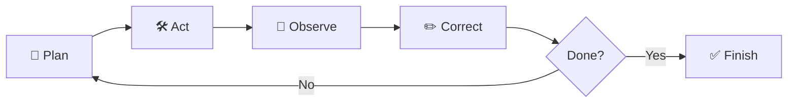

# 🗺️ Roadmap: 6 Weeks to Building AI Agents

This is my learning plan. It follows the free course path from [The AI Blueprint](https://theblueprintai.substack.com/p/how-to-master-agentic-ai-full-course): **one free course per week**, each ending with something I build myself.

---

## 💡 The Big Idea

A normal chatbot answers once, from memory.
An **agent** works in a loop until the job is done:

**Plan → Act → Observe → Correct → Finish.** Everything in this roadmap is about learning to build that loop.

---

## ✅ Quick Checklist

- [ ] **Week 1:** Finish Unit 1 of the Hugging Face Agents Course
- [ ] **Week 2:** Build one agent that uses tools
- [ ] **Week 3:** Add memory to that agent
- [ ] **Week 4:** Turn it into a team of 2–3 agents
- [ ] **Week 5:** Add at least one test (eval)
- [ ] **Week 6:** Rebuild the API layer with production patterns

---

## 📅 Week 1: Foundations

**Question this week answers:** What actually makes an agent different from a chatbot?

| | |
|---|---|
| **Course** | Hugging Face Agents Course |
| **Link** | https://huggingface.co/learn/agents-course/unit0/introduction |
| **Time** | About 3–4 hours (Unit 1 only) |

**What I'll learn**
- The **Thought → Action → Observation** loop
- How an LLM decides what to do next
- How to turn a normal Python function into a tool an agent can call
- The difference between answering once and reasoning over many steps

**🔨 Do this:** Complete Unit 1 only. Skip frameworks for now.

---

## 📅 Week 2: Tools

**Question this week answers:** How does an AI decide which tool to use, and how?

| | |
|---|---|
| **Course** | Function-Calling and Data Extraction with LLMs (DeepLearning.AI) |
| **Link** | https://www.deeplearning.ai/courses/function-calling-and-data-extraction-with-llms |
| **Time** | About 1.5 hours |

**What I'll learn**
- How function calling works behind the scenes
- How to describe a tool so the model uses it correctly
- Calling several tools at once, or one after another
- Pulling clean, structured data out of messy text

**🔨 Do this:** Build one small tool-using agent. A weather lookup agent is perfect.

---

## 📅 Week 3: Memory

**Question this week answers:** How can an agent remember things after the chat ends?

| | |
|---|---|
| **Course** | Agent Memory: Building Memory-Aware Agents (DeepLearning.AI) |
| **Link** | https://www.deeplearning.ai/courses/agent-memory-building-memory-aware-agents |
| **Time** | About 2 hours |

**What I'll learn**
- Why agents without memory fail on longer tasks
- What to store, what to look up later, and what to forget
- Turning raw conversations into useful saved facts
- Letting the agent update its own memory

**🔨 Do this:** Add persistent memory to my Week 2 agent.

---

## 📅 Week 4: Multi-Agent Systems

**Question this week answers:** Can a team of agents do better than one?

| | |
|---|---|
| **Course** | Multi AI Agent Systems with crewAI (DeepLearning.AI) |
| **Link** | https://www.deeplearning.ai/courses/multi-ai-agent-systems-with-crewai |
| **Time** | About 2 hours |

**What I'll learn**
- Giving each agent a clear role and goal (planner, researcher, writer, reviewer)
- Letting agents share memory and work together
- Giving the right tools to the right agent
- Running agents one after another, in parallel, or in a hierarchy
- Adding guardrails so the team doesn't loop forever or make things up

**🔨 Do this:** Turn my single agent into a team of 2–3 agents with different roles.

---

## 📅 Week 5: Evaluation (Evals)

**Question this week answers:** How do I know my agent is actually getting better?

| | |
|---|---|
| **Course** | Evaluating AI Agents (DeepLearning.AI, with Arize AI) |
| **Link** | https://www.deeplearning.ai/courses/evaluating-ai-agents |
| **Time** | About 1.5 hours |

**What I'll learn**
- Why "it worked once" doesn't prove anything
- Testing each part of an agent, not just the final answer
- Tracing every step the agent took, so failures aren't a mystery
- Choosing the right checker: code, an LLM judge, or a human
- Running experiments to find out what to fix

**🔨 Do this:** Set up one eval for my Week 4 team. Even a simple pass/fail check counts.

---

## 📅 Week 6: Production

**Question this week answers:** What changes when real users start using my agent?

| | |
|---|---|
| **Course** | Building with the Claude API (Claude Academy) |
| **Link** | https://academy.claude.com/courses/building-with-the-claude-api |
| **Time** | About 9 hours total (the production modules alone are about 1.5 hours) |

**What I'll learn**
- Managing multi-turn conversations with the API
- Building custom tools and using web search
- Building a solid RAG pipeline (chunking, embeddings, hybrid search, reranking)
- Common agent workflow patterns: chaining, routing, parallelization
- Prompt caching to save time and money
- Connecting to outside tools with MCP

**🔨 Do this:** Rebuild my Week 4–5 agent's API calls using the production patterns.

---

## 🏁 After Week 6

- Polish my best project and put it in `projects/`
- Write a short summary post about what I learned
- Pick my next goal (for example: LangGraph, deeper RAG, or a personal agent project)

---

## 🧭 Rules I'm Following

1. **Build, don't just watch.** Every week ends with something I made and ran myself.
2. **Notes in my own words.** If I can explain it simply, I understand it.
3. **Small and daily beats big and rare.** Even 30 minutes counts.
4. **Commit every day.** `git add . && git commit -m "Day N: topic" && git push`