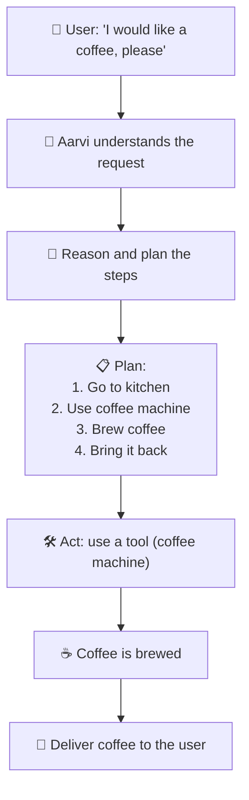
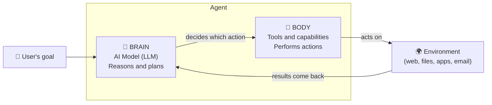
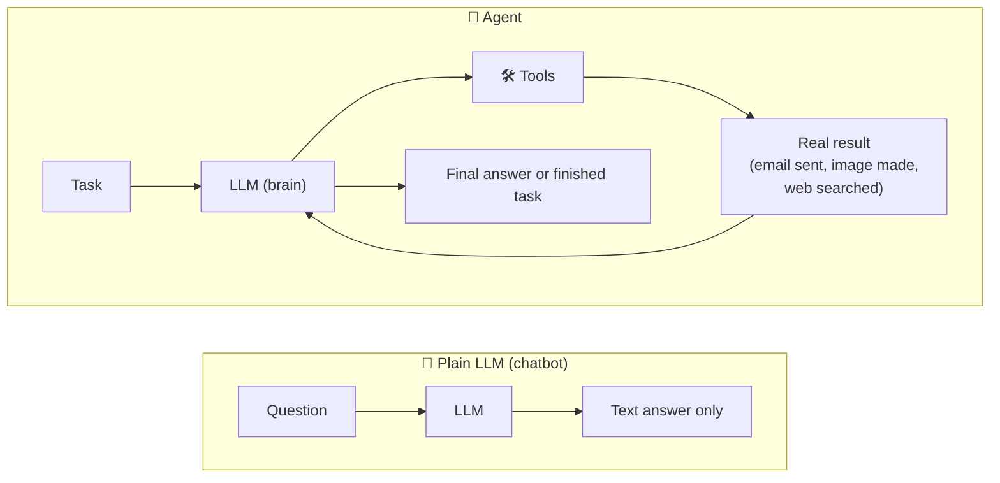
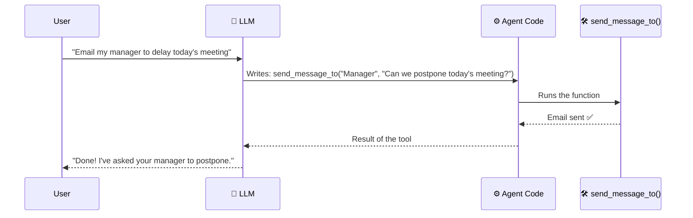
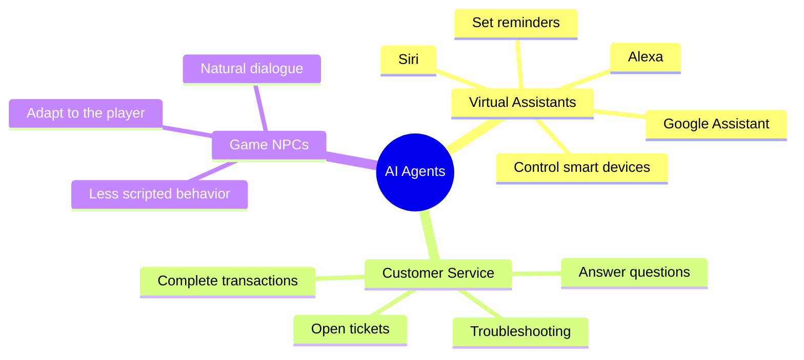

# Day 01 Diagrams: What is an Agent?

> These are [Mermaid](https://mermaid.js.org/) diagrams. They render automatically on GitHub.
> In VS Code, install the **Markdown Preview Mermaid Support** extension to preview them.

---

## 1. Aarvi the Agent: Step by Step ☕

How an agent handles a request, using the coffee example.

---

## 2. Brain + Body of an Agent 🧠🦾

An agent is made of a thinking part and an acting part.

---

## 3. Chatbot vs Agent 💬 vs 🤖

The main difference: a plain LLM only produces text, while an agent can take real actions.

---

## 4. How an LLM Uses a Tool 🔧

The LLM only writes text. The surrounding code is what actually runs the tool.

---

## 5. Real-World Agent Examples 🌍

