# Day 02 Diagrams: What are LLMs?

> These are [Mermaid](https://mermaid.js.org/) diagrams. They render automatically on GitHub.
> In VS Code, install the **Markdown Preview Mermaid Support** extension to preview them.

---

## 1. The 3 Types of Transformers 🧩

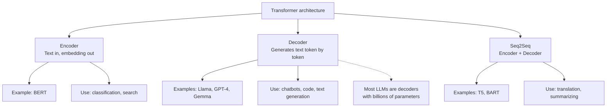

---

## 2. Tokenization: Words to Tokens ✂️

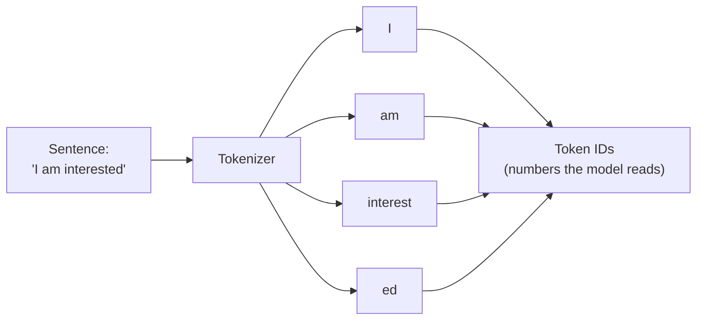

Small vocabulary of about 32,000 tokens can build all the words we need, because tokens combine: `interest` + `ed` = interested.

---

## 3. Next Token Prediction (One Step) 🔮

What happens each time the model produces one token.

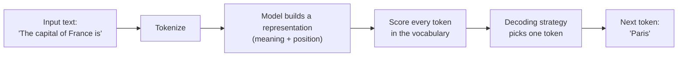

Example scores for the next token:

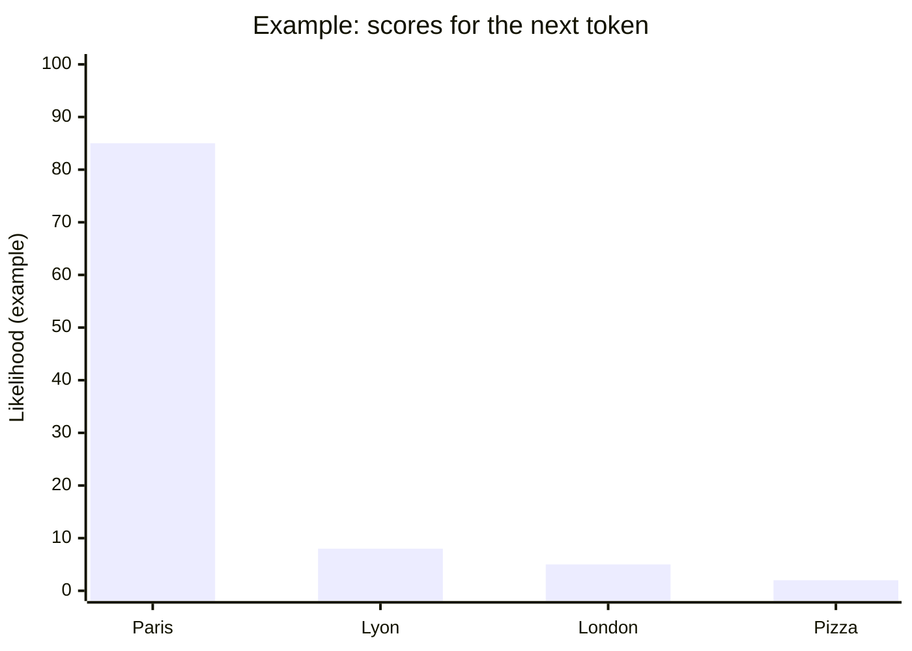

---

## 4. The Autoregressive Loop 🔁

The output of each step becomes part of the input for the next step, until the model predicts EOS.

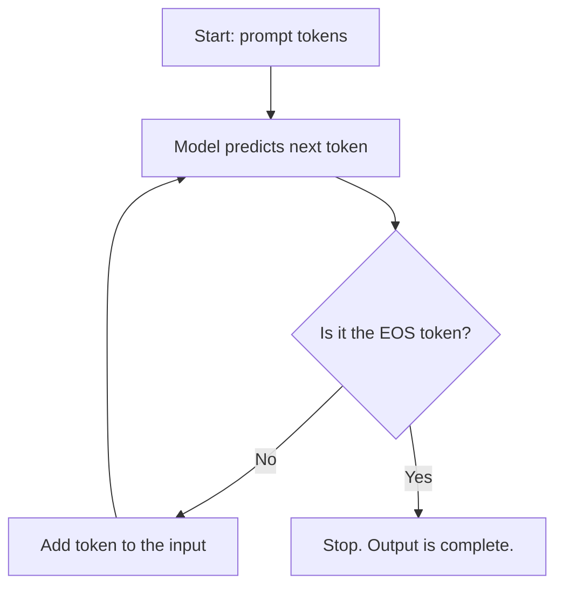

Step-by-step view:

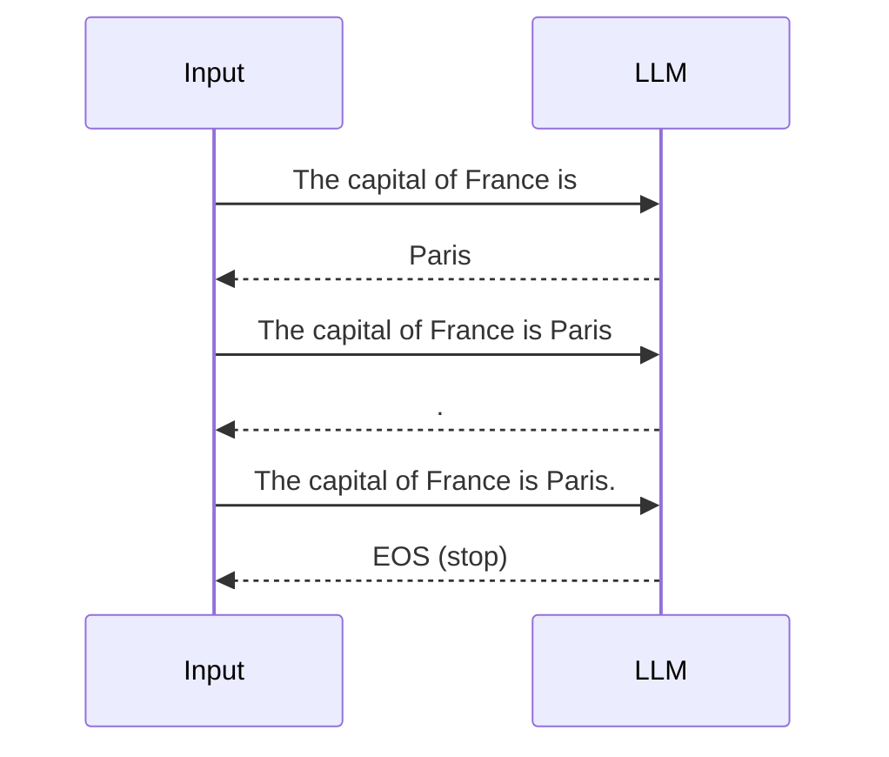

---

## 5. Decoding Strategies: Greedy vs Beam Search 🎯

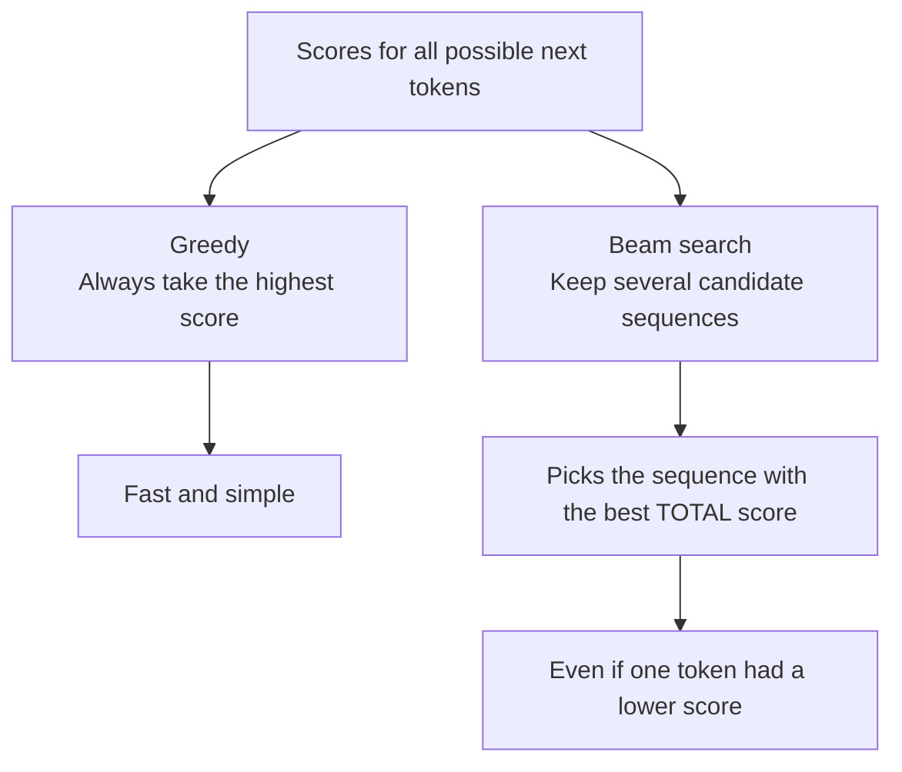

---

## 6. Attention: Focus on What Matters 👀

For the sentence "The capital of France is ...", some words matter more than others.

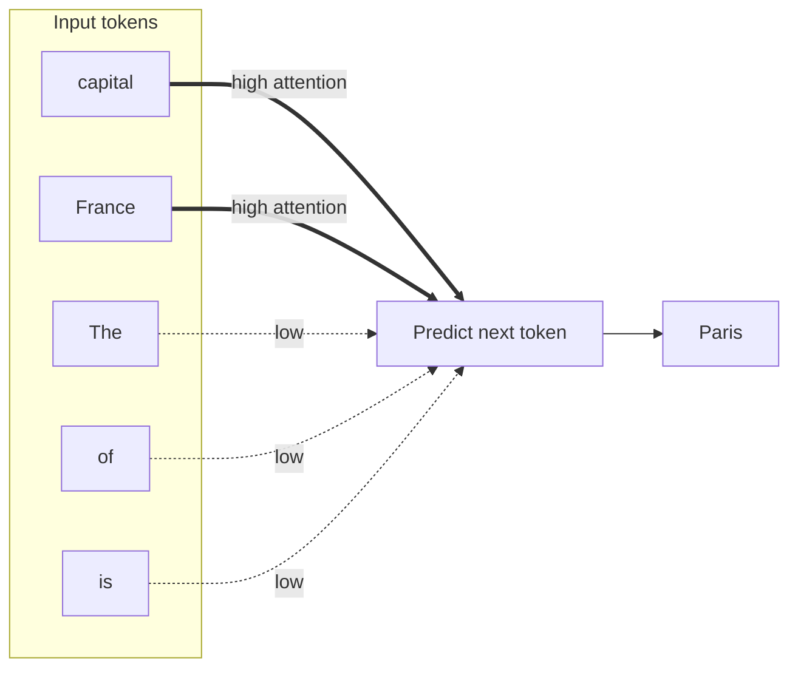

Context length is the maximum number of tokens the model can pay attention to at once:

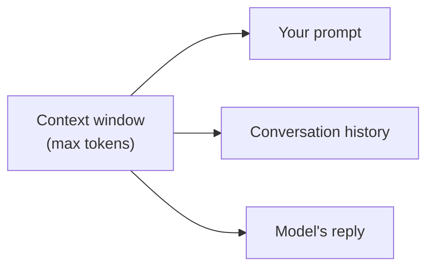

---

## 7. Why Prompting Matters ✍️

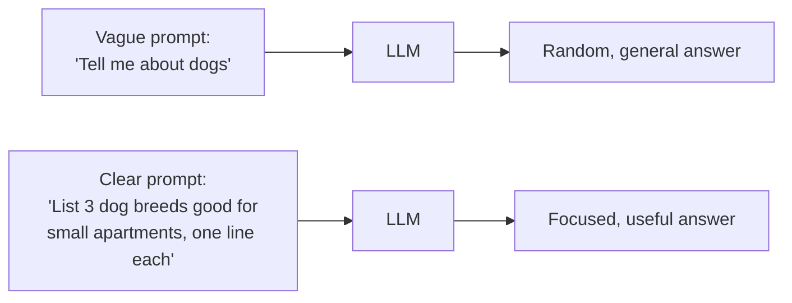

---

## 8. How LLMs Are Trained 🏋️

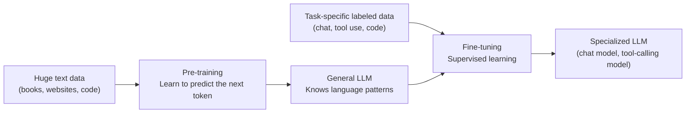

---

## 9. How Can I Use LLMs? 💻

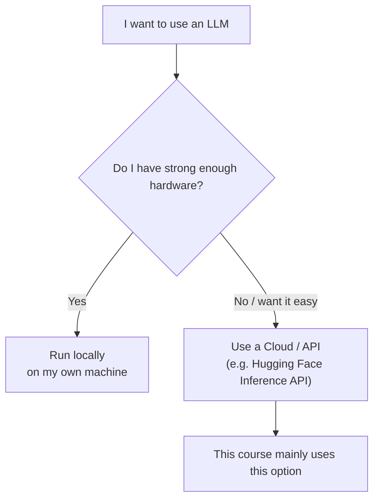

---

## 10. LLM as the Brain of an Agent 🤖

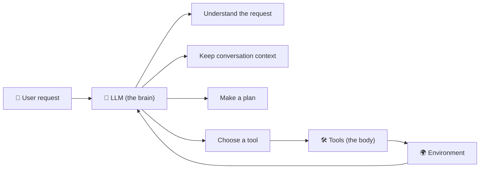

---

## 11. Day 2 Mind Map 🗺️

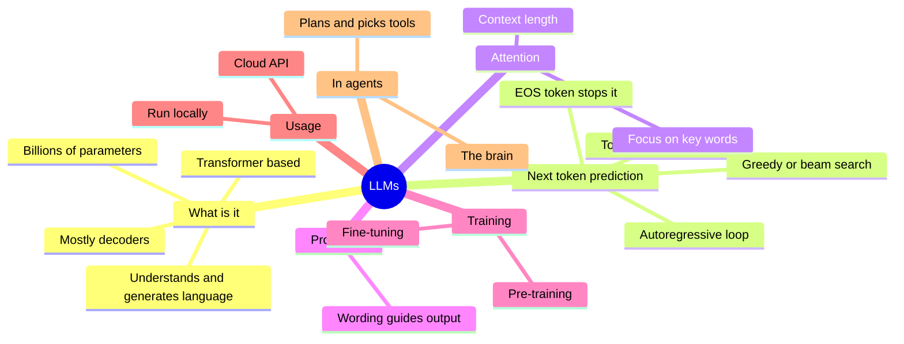