# Day 03 Diagrams: Messages and Special Tokens

> These are [Mermaid](https://mermaid.js.org/) diagrams. They render automatically on GitHub.
> In VS Code, install the **Markdown Preview Mermaid Support** extension to preview them.

---

## 1. Chat UI vs What the Model Really Sees 💬

The chat looks like separate messages, but the model gets one long prompt.

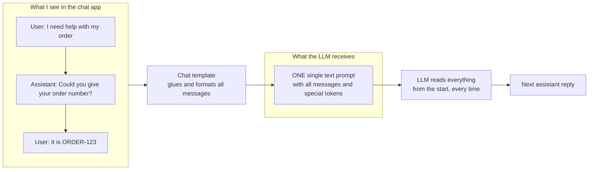

**Remember:** the model does not remember. The full history is re-sent each turn.

---

## 2. The 3 Message Roles 🏷️

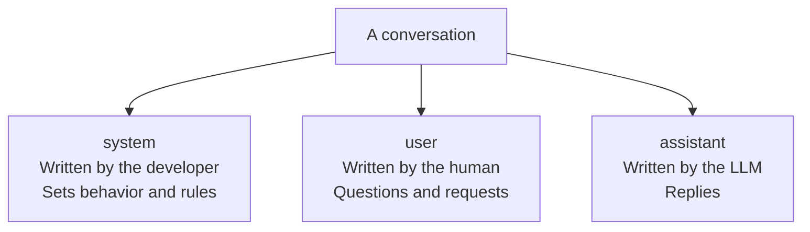

---

## 3. System Message Changes Behavior 🎭

Same model, same user question. Only the system message is different.

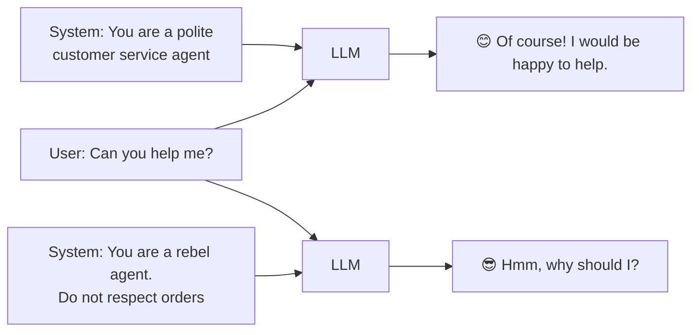

---

## 4. What a System Message Holds in an Agent 🤖

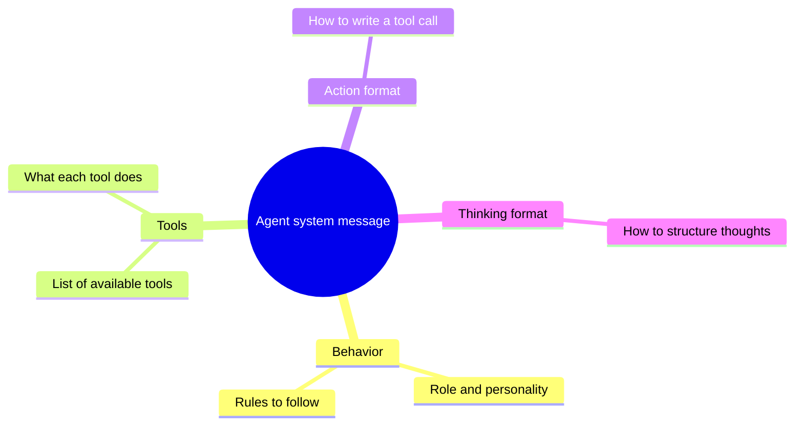

---

## 5. Multi-Turn Conversation as a List 📜

Each new turn adds to the list. The whole list goes to the model.

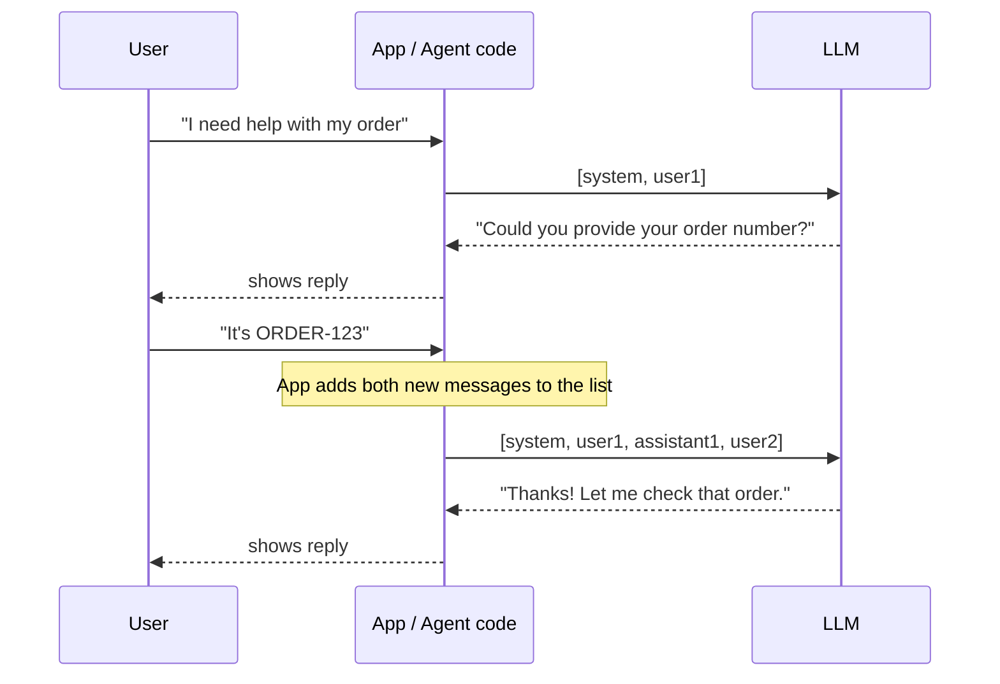

---

## 6. Chat Template: Messages In, Prompt Out 🧱

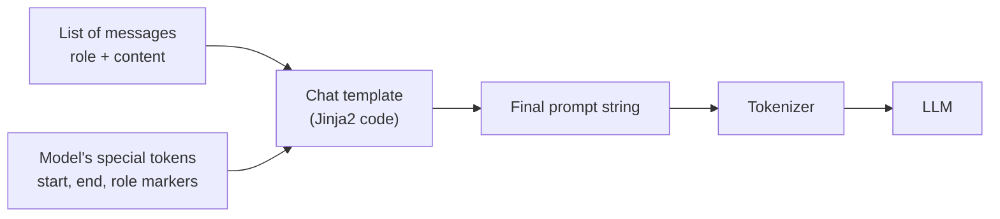

### The template loop (simplified idea)

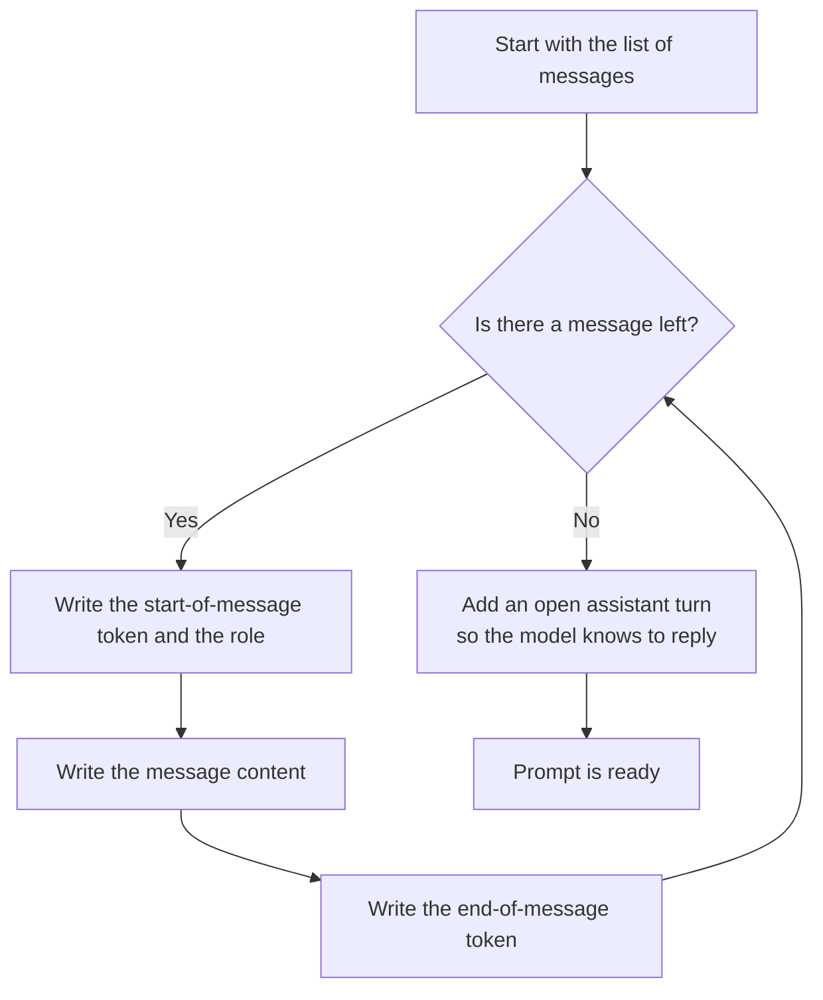

---

## 7. Same Conversation, Different Models 🔀

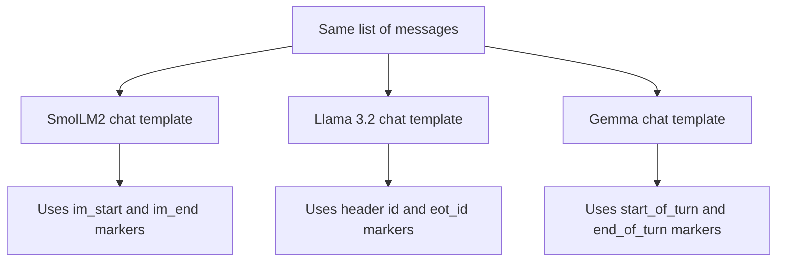

Each model expects its **own** format, so always use the **matching** chat template.

---

## 8. Base Model vs Instruct Model 🆚

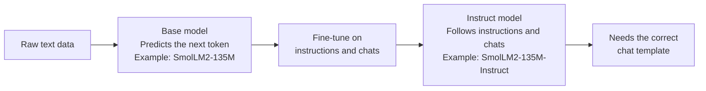

---

## 9. Code Flow: apply_chat_template 💻

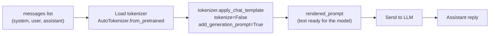

---

## 10. Day 3 Mind Map 🗺️

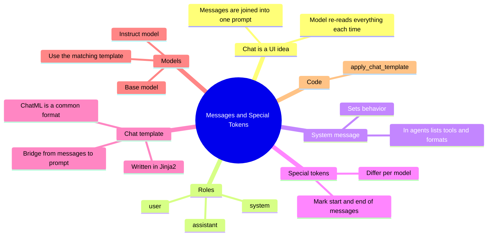